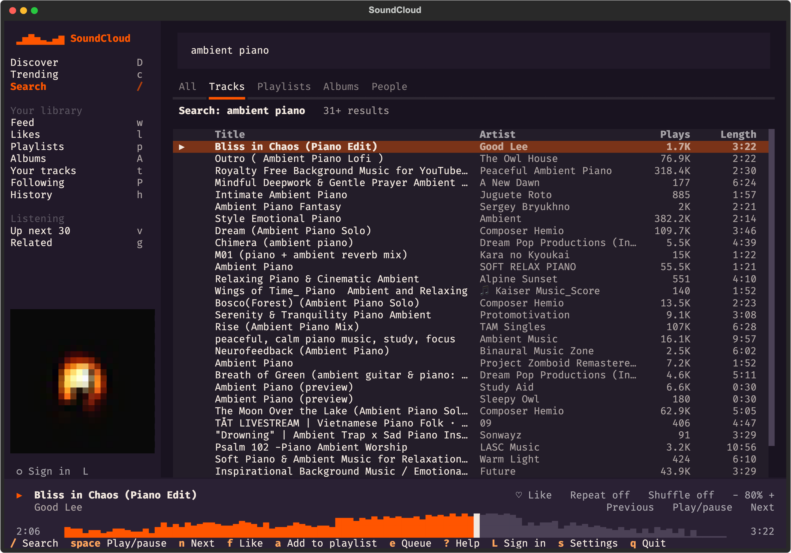

# SoundCloud TUI

A SoundCloud client for your terminal. Search, play, like, repost, follow, and manage playlists, with your track's waveform as the progress bar and your listening shown in Discord.

Built with [Textual](https://textual.textualize.io/). Plays audio through `mpv` or `ffplay`.

## Preview



## Features

- **Search as you type**, filtered by tracks, playlists, albums, or people. Paste a SoundCloud link to open it.
- **Your account:** like tracks and playlists, repost, follow people, and create and edit playlists, including private ones.
- **Your library:** feed, likes, playlists, albums, your tracks, following, and listening history.
- **Discover:** trending tracks and SoundCloud's curated and genre playlists.
- **Playback:** seek by clicking the waveform, volume, shuffle, repeat, an Up next queue, and related tracks.
- **Discord Rich Presence** with the track, artist, cover art, and time remaining.

## Install

You need an audio player and the app. The app runs on Windows, macOS, and Linux with Python 3.10 or newer.

### 1. Install an audio player

`mpv` is recommended. `ffplay`, which comes with FFmpeg, works too, but it restarts the stream when you seek or change the volume, so you hear a short gap.

| System | mpv | or FFmpeg |
| --- | --- | --- |
| Windows | `winget install shinchiro.mpv` | `winget install Gyan.FFmpeg` |
| macOS | `brew install mpv` | `brew install ffmpeg` |
| Debian, Ubuntu | `sudo apt install mpv` | `sudo apt install ffmpeg` |
| Fedora | `sudo dnf install mpv` | `sudo dnf install ffmpeg` |
| Arch | `sudo pacman -S mpv` | `sudo pacman -S ffmpeg` |

On Windows, Scoop (`scoop install extras/mpv`) and Chocolatey (`choco install mpv`) work as well. The app finds the player even when your current terminal hasn't picked up the new `PATH` yet.

### 2. Install the app

The easiest way is [uv](https://docs.astral.sh/uv/), which also downloads Python if you don't have it:

```bash
# Windows: winget install astral-sh.uv
# macOS:   brew install uv
# Linux:   curl -LsSf https://astral.sh/uv/install.sh | sh

uv tool install git+https://github.com/dzeveckij/soundcloud-rpc-tui
```

If you already use [pipx](https://pipx.pypa.io/), run `pipx install git+https://github.com/dzeveckij/soundcloud-rpc-tui` instead.

If your terminal then says it can't find `soundcloud-rpc-tui`, run `uv tool update-shell` (or `pipx ensurepath`) and open a new terminal.

To update, run `uv tool upgrade soundcloud-rpc-tui`. To uninstall, run `uv tool uninstall soundcloud-rpc-tui`.

## Run

```bash
soundcloud-rpc-tui
```

On Windows, use [Windows Terminal](https://aka.ms/terminal), which comes with Windows 11. The older console window can't show the waveform and cover art properly.

## Sign in

Press `L`. The app uses the SoundCloud session in your browser, so your password never reaches it.

1. Sign in on soundcloud.com, if you haven't already.
2. Choose that browser in the app and select **Import session**.

Firefox, Chrome, Brave, Edge, Chromium, Vivaldi, Opera, and Safari are supported, with a few limits on each system:

- **Windows:** use Firefox. Chrome, Edge, and Brave encrypt their cookies so that other apps can't read them, and they lock them while the browser is open. For those browsers, paste the token instead (see below).
- **macOS:** Chromium-based browsers ask for Keychain access, and Safari needs Full Disk Access for your terminal.
- **Linux:** Chromium-based browsers may ask your keyring (GNOME Keyring or KWallet) to unlock their cookies.

**Pasting a token instead.** On soundcloud.com, open the developer tools (`F12`). Under **Application** (Chrome, Edge) or **Storage** (Firefox), open **Cookies** › `https://soundcloud.com` and copy the value of `oauth_token`. Paste it into the `L` dialog. Add `oauth_refresh_token` as well to stay signed in longer. You can also give the path to a `cookies.txt` export.

**Staying signed in.** SoundCloud sessions renew about every hour using a single-use refresh token that your browser and this app share. The app reads your browser again first, which doesn't affect the browser at all. If the browser's session has also expired, the app renews it, and your browser may then ask you to sign in again the next time you open SoundCloud.

**Your tokens** are saved in `auth.json` in the app's settings folder (see [Settings](#settings)), readable only by your user, and are only ever sent to SoundCloud. **Sign out** in the `L` dialog deletes that file.

Not signing in? Set a public profile in settings (`s`) to browse its likes, playlists, and tracks. Search, Trending, Discover, and playback work without an account.

## Controls

Press `?` in the app for this list. Most on-screen controls can also be clicked.

### Browse

| Key | Action |
| --- | --- |
| `/` | Search, or paste a SoundCloud link |
| `enter` | Play a track, or open a playlist or person |
| `backspace` | Go back |
| `[` `]` | Change the search filter |
| `r` | Refresh this view |
| `j` `k` | Move down or up |
| `D` `c` `w` | Discover, Trending, Feed |
| `l` `p` `A` | Likes, Playlists, Albums |
| `t` `P` `h` | Your tracks, Following, History |
| `v` `g` | Up next, Related to this track |

### Playback

| Key | Action |
| --- | --- |
| `space` | Play or pause |
| `n` `b` | Next, Previous |
| `←` `→` | Back or forward 10 seconds |
| `-` `+` | Volume down or up |
| `y` | Repeat: off, all, one |
| `z` | Shuffle |
| `e` | Add the selected track to Up next |

### Your account

| Key | Action |
| --- | --- |
| `f` | Like the selected row, or follow a person |
| `F` | Like the track that's playing |
| `a` | Add to a playlist |
| `R` | Repost, or undo a repost |
| `d` | Remove from Up next or your playlist, or delete your playlist |
| `L` | Sign in or sign out |

### Other

| Key | Action |
| --- | --- |
| `i` | Details about the selected row |
| `o` `u` | Open the selected row or its artist in your browser |
| `s` | Settings |
| `q` | Quit |

## Settings

Settings and your sign-in are saved in:

| System | Folder |
| --- | --- |
| Windows | `%APPDATA%\soundcloud-rpc-tui` |
| macOS, Linux | `~/.config/soundcloud-rpc-tui`, or `$XDG_CONFIG_HOME/soundcloud-rpc-tui` if that's set |

Played tracks are added to your SoundCloud listening history, as they are on the website. Turn this off in settings if you'd rather they weren't.

## Troubleshooting

**No sound, or "No audio player found."** Install `mpv` or FFmpeg (see [Install](#install)). If you installed it somewhere unusual, add its folder to your `PATH` and open a new terminal.

**"That browser isn't signed in to SoundCloud."** Sign in on soundcloud.com in that browser, then import again. If you use several profiles, the app checks each one, starting with the most recently used.

**Chrome or Edge won't import on Windows.** This is expected. Use Firefox, or paste the token.

**Boxes or question marks instead of the waveform.** Your terminal's font is missing block characters. Use Windows Terminal, iTerm2, or any terminal with a modern font such as Cascadia Code, Menlo, or DejaVu Sans Mono.

**"Your SoundCloud session expired."** Press `L` and import your session again.

**A track plays for only 30 seconds.** It's a SoundCloud Go+ track and you're hearing its preview. The player labels these.

**"SoundCloud isn't accepting this app right now."** The app couldn't get an API key from SoundCloud. Wait a while, then try again. Once it has a working key, it reuses it without contacting the website.

**Discord doesn't update.** Make sure Discord's desktop app is running. Settings (`s`) shows the connection status.

## Good to know

This app uses `api-v2.soundcloud.com`, the private API behind SoundCloud's website, because it's the only one with search, likes, and streaming for ordinary accounts. SoundCloud can change it at any time, and account actions here affect your real account.

## Development

```bash
git clone https://github.com/dzeveckij/soundcloud-rpc-tui
cd soundcloud-rpc-tui
uv venv && uv pip install -e '.[dev]'   # or: python -m venv .venv, then pip install -e '.[dev]'
uv run pytest
```

You can also run the app from the checkout with `uv run soundcloud-rpc-tui` or `python -m soundcloud_rpc_tui`. GitHub Actions runs the tests on Windows, macOS, and Linux.

The code lives in `src/soundcloud_rpc_tui`:

| Path | Purpose |
| --- | --- |
| `core.py` | Data types, settings, the play queue, and formatting helpers |
| `auth.py` | Sign-in, token storage, and session renewal |
| `soundcloud.py` | The SoundCloud API client |
| `player.py` | Audio playback through `mpv` or `ffplay` |
| `integrations.py` | Discord Rich Presence |
| `ui/app.py` | The main app: views, playback control, and key bindings |
| `ui/screens.py` | Dialogs: sign-in, playlists, settings, and help |
| `ui/widgets.py` | The waveform, player bar, sidebar, track list, and themes |
