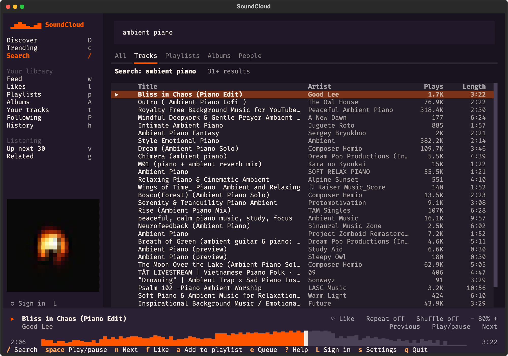

# SoundCloud TUI

A SoundCloud client for your terminal. Search, play, like, repost, follow, and manage playlists, with your track's waveform as the progress bar and your listening shown in Discord.

Built with [Textual](https://textual.textualize.io/). Plays audio through `mpv` or `ffplay`.

## Preview



## Features

- **Search as you type**, filtered by tracks, playlists, albums, or people. Paste a SoundCloud link to open it.
- **Your account:** like tracks and playlists, repost, follow people, and create and edit playlists, including private ones.
- **Your library:** feed, likes, playlists, albums, your tracks, following, and listening history.
- **Discover:** trending tracks and SoundCloud's curated and genre playlists.
- **Playback:** seek by clicking the waveform, volume, shuffle, repeat, an Up next queue, and related tracks.
- **Discord Rich Presence** with the track, artist, cover art, and time remaining.

## Requirements

- Python 3.10 or newer
- `mpv` (recommended) or `ffplay` from FFmpeg

```bash
brew install mpv         # macOS
sudo apt install mpv     # Debian and Ubuntu
```

`ffplay` works too, but it restarts the stream when you seek or change the volume, which causes a short gap. `mpv` does both instantly.

## Install

```bash
python -m venv .venv
source .venv/bin/activate
python -m pip install -e .
```

## Run

```bash
soundcloud-rpc-tui
```

Or run `python app.py` from the checkout.

## Sign in

Press `L`. The app uses the SoundCloud session in your browser, so your password never reaches it.

1. Sign in on soundcloud.com, if you haven't already.
2. Choose that browser in the app and select **Import session**.

Firefox, Chrome, Brave, Edge, Chromium, Vivaldi, Opera, and Safari are supported. On macOS, Chromium-based browsers ask for Keychain access, and Safari needs Full Disk Access for your terminal. For any other browser, paste the `oauth_token` cookie from its developer tools, or the path to a `cookies.txt` export. Add the `oauth_refresh_token` cookie to stay signed in longer.

**Staying signed in.** SoundCloud sessions renew about every hour using a single-use refresh token that your browser and this app share. The app reads your browser again first, which doesn't affect the browser at all. If the browser's session has also expired, the app renews it, and your browser may then ask you to sign in again the next time you open SoundCloud.

**Your tokens** are saved in `~/.config/soundcloud-rpc-tui/auth.json`, readable only by your user, and are only ever sent to SoundCloud. **Sign out** in the `L` dialog deletes that file.

Not signing in? Set a public profile in settings (`s`) to browse its likes, playlists, and tracks. Search, Trending, Discover, and playback work without an account.

## Controls

Press `?` in the app for this list. Most on-screen controls can also be clicked.

### Browse

| Key | Action |
| --- | --- |
| `/` | Search, or paste a SoundCloud link |
| `enter` | Play a track, or open a playlist or person |
| `backspace` | Go back |
| `[` `]` | Change the search filter |
| `r` | Refresh this view |
| `j` `k` | Move down or up |
| `D` `c` `w` | Discover, Trending, Feed |
| `l` `p` `A` | Likes, Playlists, Albums |
| `t` `P` `h` | Your tracks, Following, History |
| `v` `g` | Up next, Related to this track |

### Playback

| Key | Action |
| --- | --- |
| `space` | Play or pause |
| `n` `b` | Next, Previous |
| `←` `→` | Back or forward 10 seconds |
| `-` `+` | Volume down or up |
| `y` | Repeat: off, all, one |
| `z` | Shuffle |
| `e` | Add the selected track to Up next |

### Your account

| Key | Action |
| --- | --- |
| `f` | Like the selected row, or follow a person |
| `F` | Like the track that's playing |
| `a` | Add to a playlist |
| `R` | Repost, or undo a repost |
| `d` | Remove from Up next or your playlist, or delete your playlist |
| `L` | Sign in or sign out |

### Other

| Key | Action |
| --- | --- |
| `i` | Details about the selected row |
| `o` `u` | Open the selected row or its artist in your browser |
| `s` | Settings |
| `q` | Quit |

## Settings

Settings are saved to `~/.config/soundcloud-rpc-tui/settings.json`, or under `$XDG_CONFIG_HOME` if it's set.

Played tracks are added to your SoundCloud listening history, as they are on the website. Turn this off in settings if you'd rather they weren't.

## Troubleshooting

**No sound, or "No audio player found."** Install `mpv` or FFmpeg, and make sure it's on your `PATH`.

**"That browser isn't signed in to SoundCloud."** Sign in on soundcloud.com in that browser, then import again. If you use several profiles, the app checks each one, starting with the most recently used.

**"Your SoundCloud session expired."** Press `L` and import your session again.

**A track plays for only 30 seconds.** It's a SoundCloud Go+ track and you're hearing its preview. The player labels these.

**"SoundCloud isn't accepting this app right now."** The app couldn't get an API key from SoundCloud. Wait a while, then try again. Once it has a working key, it reuses it without contacting the website.

**Discord doesn't update.** Make sure Discord's desktop app is running. Settings (`s`) shows the connection status.

## Good to know

This app uses `api-v2.soundcloud.com`, the private API behind SoundCloud's website, because it's the only one with search, likes, and streaming for ordinary accounts. SoundCloud can change it at any time, and account actions here affect your real account.

## Development

```bash
python -m pip install -e '.[dev]'
python -m pytest
```
